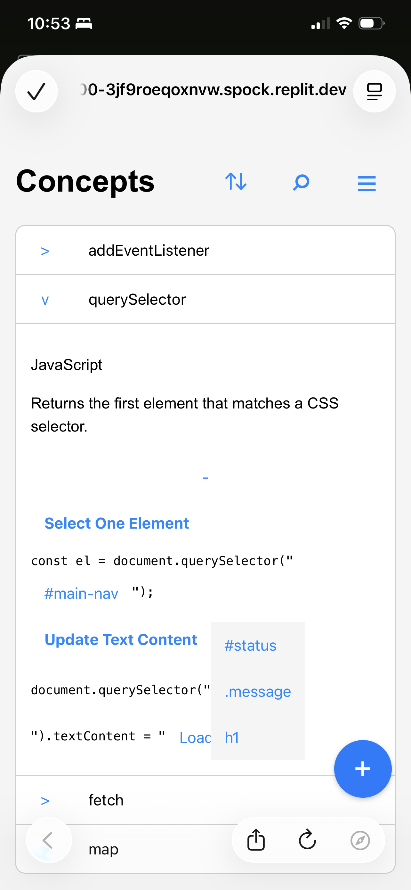

# CodeWeave

CodeWeave is an early-stage learning and snippet-building application for storing programming concepts, examples, and reusable code patterns. It is built around a simple idea: code examples become easier to understand and reuse when the parts that commonly change are represented as editable **slots**.

A concept can contain one or more examples, each example can contain placeholder slots, and each slot can provide selectable options. This allows a learner to experiment with code patterns without rewriting an entire snippet while also creating the foundation for a practical personal snippet library.

## Current Status

**CodeWeave is a functional, locally run prototype under active development. It is not currently deployed.**

The core data model, API, concept viewer, concept create/edit workflow, and interactive slot rendering are working. The next major milestone is completing the user interface for creating and managing examples, slots, and slot options.

CodeWeave currently operates as a single-user development prototype. Authentication, user accounts, and content ownership are intentionally deferred until the core authoring and snippet-building workflows are complete and stable.

## Project Goals

CodeWeave is being built from scratch as a full-stack portfolio project with two primary goals:

1. **Learning tool** - Help newer developers understand programming concepts through interactive examples.
2. **Snippet tool** - Give developers a place to store, customize, and eventually copy reusable snippets into their own projects.

The project is being developed in stages so the data model, CRUD behavior, and core user interactions are solid before authentication, deployment, and larger-scale features are introduced.

## Current Features

- [x] FastAPI backend application structure
- [x] SQLAlchemy models for concepts, examples, slots, and slot options
- [x] SQLite-compatible local database setup
- [x] Alembic migration setup
- [x] REST-style routes for concepts, examples, slots, and slot options
- [x] Nested API operations for saving concepts with related content
- [x] Health-check endpoints
- [x] Static frontend served by FastAPI
- [x] Concept list page
- [x] Concept create/edit form
- [x] Expandable concept details
- [x] Example rendering for each concept
- [x] Slot placeholder parsing using `##Slot Label##` syntax
- [x] Interactive slot-option selection in rendered examples
- [x] Client-side search and alphabetical sorting
- [x] Seed data for initial learning examples

## Current Limitations

- The visual editing workflow for examples, slots, and slot options is incomplete.
- Authentication and user ownership are not yet implemented.
- The application currently uses SQLite for local development.
- The project is not yet deployed as a public demo.
- Automated test coverage is still planned.

These limitations reflect the project's current development stage rather than its intended final scope.

## How It Works

CodeWeave uses a nested content model:

```text
Concept
`-- Example
    `-- Slot
        `-- Slot Option
```

For example, an `addEventListener` concept can contain an example such as:

```js
document.querySelector("##Target##")
  .addEventListener("##Event Type##", () => {
    console.log("##Message##");
  });
```

Each placeholder maps to a slot. Each slot can have multiple selectable options, such as:

- `Target`: `#submit-btn`, `.card`, `button`, `form`
- `Event Type`: `click`, `submit`, `keydown`
- `Message`: `clicked`, `submitted`, `hovered`

The frontend parses the placeholder syntax, replaces each placeholder with an interactive control, and allows the user to try different combinations without rewriting the full example.

## Mobile Screenshot



## Tech Stack

### Backend

- Python
- FastAPI
- SQLAlchemy
- Pydantic
- Alembic
- SQLite for local development

### Frontend

- HTML
- CSS
- Modular vanilla JavaScript
- Browser Fetch API

### Development Environment

- Replit
- Git and GitHub

## Repository Structure

```text
CodeWeave/
|-- alembic/              # Database migration configuration and versions
|-- models/               # SQLAlchemy database models
|-- routers/              # FastAPI route modules
|-- schemas/              # Pydantic request and response schemas
|-- static/
|   |-- js/               # Frontend JavaScript modules
|   `-- styles.css        # Application styling
|-- templates/            # HTML pages served by FastAPI
|-- db.py                 # Database engine, session, and dependency setup
|-- main.py               # FastAPI application entry point
|-- seed.py               # Local seed-data script
`-- requirements.txt      # Python dependencies
```

## Local Development

### Prerequisites

- Python 3.11 or newer
- Git

### 1. Clone the repository

```bash
git clone https://github.com/timmuh03/CodeWeave.git
cd CodeWeave
```

### 2. Create and activate a virtual environment

macOS or Linux:

```bash
python3 -m venv .venv
source .venv/bin/activate
```

Windows PowerShell:

```powershell
python -m venv .venv
.\.venv\Scripts\Activate.ps1
```

### 3. Install dependencies

```bash
pip install -r requirements.txt
```

### 4. Configure environment variables

Create a `.env` file in the project root:

```env
DATABASE_URL=sqlite:///./codeweave.db
START_PAGE=./templates/index.html
```

### 5. Seed the database

```bash
python seed.py
```

> The seed script resets the local database before inserting the initial sample data.

### 6. Run the development server

```bash
uvicorn main:app --reload
```

Open the application at:

```text
http://127.0.0.1:8000
```

FastAPI's interactive API documentation is available at:

```text
http://127.0.0.1:8000/docs
```

## Roadmap

### Phase 1: Core Concept Application

- [x] Create the backend project structure
- [x] Create the relational database models
- [x] Add concept CRUD routes
- [x] Add example, slot, and option routes
- [x] Build the concept-list interface
- [x] Build the concept create/edit form
- [x] Render concept examples
- [x] Parse slots from example text
- [x] Allow users to select slot options in rendered examples

### Phase 2: Complete the Editing Workflow

- [ ] Add a complete UI for creating examples within a concept
- [ ] Add controls for editing example titles and code text
- [ ] Add controls for deleting examples
- [ ] Add a workflow for creating slots from selected example text
- [ ] Add controls for editing slot labels and slot types
- [ ] Add controls for creating, editing, deleting, and ordering slot options
- [ ] Validate that example placeholders match their defined slots
- [ ] Improve error handling and form feedback
- [ ] Add confirmation before deleting content

### Phase 3: Snippet-Builder Features

- [ ] Add a live generated-code preview
- [ ] Add copy-to-clipboard functionality
- [ ] Preserve selected slot values while viewing an example
- [ ] Link repeated slots so changing one updates matching occurrences
- [ ] Allow authors to define whether repeated slot labels are linked or independent
- [ ] Add basic slot metadata such as variable, string, number, selector, callback, or expression

### Phase 4: Validation and Testing

- [ ] Add rules for compatible slot combinations
- [ ] Warn about questionable combinations without unnecessarily blocking users
- [ ] Support language-specific validation
- [ ] Support library- and framework-specific suggestions
- [ ] Add optional required imports and setup notes
- [ ] Add automated tests for APIs, slot parsing, nested updates, and generated output

### Phase 5: Organization and Discovery

- [ ] Add languages as first-class organizational fields
- [ ] Add library and framework categories under each language
- [ ] Add tags for concepts and snippets
- [ ] Add server-side search and filtering
- [ ] Add additional sorting options
- [ ] Add favorites or saved filters
- [ ] Add import and export for snippet packs

### Phase 6: Authentication, Sharing, and Deployment

- [ ] Add user registration and authentication after the core workflow is stable
- [ ] Add ownership and permissions for user-created content
- [ ] Add public and private snippet visibility
- [ ] Add pagination or incremental loading as the content library grows
- [ ] Configure a persistent production database
- [ ] Add deployment configuration
- [ ] Add continuous-integration checks for formatting, tests, and migrations

## Design Notes

### Why slots?

Many code examples contain pieces that change from one project to another: variable names, selectors, endpoint URLs, event names, callbacks, messages, and configuration values. CodeWeave treats those changing pieces as structured slots, turning static examples into reusable templates.

### Why use vanilla JavaScript first?

The frontend intentionally uses browser-native JavaScript modules rather than a framework. This keeps the early project focused on core skills such as DOM rendering, event handling, Fetch API requests, client-side state management, and backend integration.

A framework can be considered later if the application's complexity grows enough to justify it.

### Why finish editing before authentication and deployment?

The current priority is to complete the application's central workflow:

1. Create a concept.
2. Add examples.
3. Define slots within those examples.
4. Add valid options for each slot.
5. Preview and copy the generated snippet.

Once this workflow is reliable and intuitive, authentication, ownership, deployment, and scaling can be added around a stable product foundation rather than an incomplete one.

## Portfolio Focus

This project demonstrates:

- Full-stack application planning
- Relational data modeling
- REST-style API design
- Nested create and update operations
- Pydantic request and response schema design
- Frontend state and DOM management without a framework
- Integration between browser JavaScript and FastAPI endpoints
- Database seeding and schema migrations
- Incremental feature development and debugging
- Product thinking around learning, snippet reuse, validation, and future scalability
